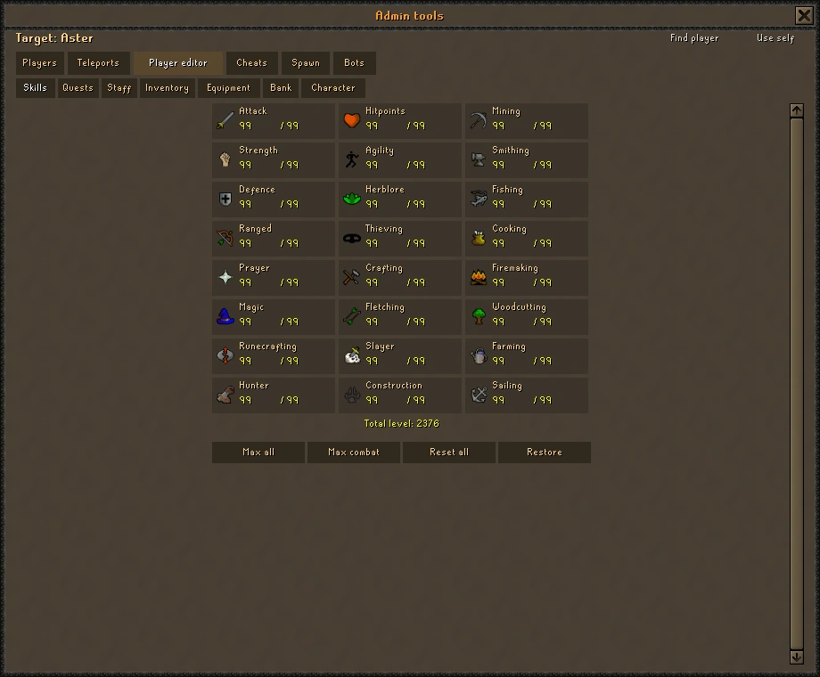
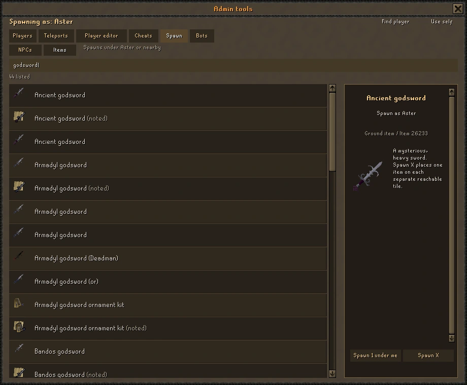
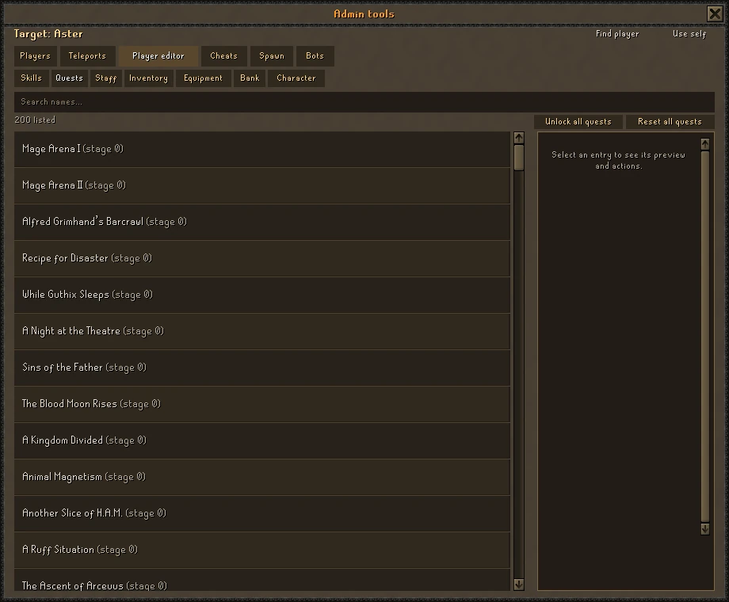

# In-game admin panel

Requires [TSPS #6777](https://github.com/RSPSApp/tsps/pull/6777) for bulk quest actions, plus the native interface controls and shared admin services in [TSPS #6742](https://github.com/RSPSApp/tsps/pull/6742) and [TSPS #6746](https://github.com/RSPSApp/tsps/pull/6746).

Author: GhostScape. This bundle uses [TSPS commit e408bebf5](https://github.com/RSPSApp/tsps/commit/e408bebf52b40aa8d1e32eb3a48db35a43cc07e5).

In-game player editing, teleports, cheats, spawning and bot controls.

Install the release ZIP in the server Plugins panel and restart the server. This package does not patch or rebuild the client. Use a TSPS build with the integrations listed above. The source entry ends in `.entry.js` so it is not auto-loaded alongside this package.

Open `::admin` with an authorised account. Actions retain their rank, command, target-session and world-profile checks. Bots use the shared runtime service and work without the old standalone `::bots` UI. Teleport, quest, spawn and bot providers must be present in the receiving TSPS build. Unlock all quests completes registered quests and supported miniquests with rewards. Reset all quests resets registered quest stages and points, keeping rewards and separate miniquest progress; some quest-specific state can remain. Both bulk actions require typing CONFIRM.

## Rebuild the package

Run `npm ci` in the Hub repository with Node.js 22 and install the TSPS client dependencies from the source revision's lockfile. Run these commands from the Hub repository root.

The rebuild script requires [Hub #6](https://github.com/RSPSApp/tsps-plugins/pull/6).

```sh
tsps=/path/to/tsps
hub=/path/to/tsps-plugins
cd "$hub"
npm ci
node scripts/bundle-plugin.mjs "$tsps" admin-panel server/plugins/tools/AdminPanel.entry.js
python3 scripts/package-plugin.py admin-panel
```

The JavaScript entry includes its local helpers, JSON data and the TSPS BSD 2-Clause license. The ZIP contains that entry and `plugin.json`. Remove or disable the installed package through the normal Plugins workflow.

## Screenshots






