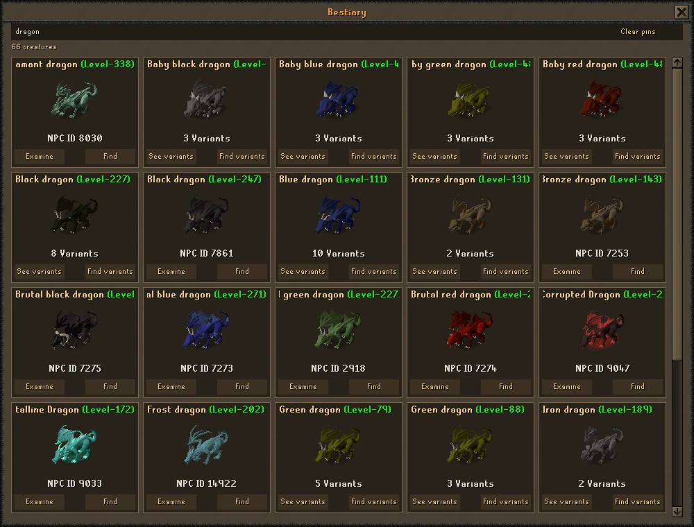

# Bestiary

Author: GhostScape. Source: the matching GhostScape feature changes for RSPSApp/tsps.

Search playable monsters and show their known public spawn locations. Requires the matching TSPS Bestiary client and encounter providers.

Install the release ZIP in the server Plugins panel and restart the server. Use a server and client build with the support from [TSPS #6742](https://github.com/RSPSApp/tsps/pull/6742) and [TSPS #6743](https://github.com/RSPSApp/tsps/pull/6743). The source entry ends in `.entry.js` so it is not auto-loaded alongside this package.

Open `::bestiary`, or use the client Commands list. Find places temporary pins for known public spawn homes. Browsing does not spawn NPCs or start encounters. Install Monster Examine for detailed monster pages; the catalogue itself can remain available without it. Keep the matching client Monster Examine/Bestiary integration enabled for map pins.

Rebuilding the bundle uses `scripts/bundle-plugin.mjs` from [Hub PR #6](https://github.com/RSPSApp/tsps-plugins/pull/6). With that script available in the Hub checkout, install the matching TSPS checkout's client dependencies and run these commands from the Hub repository root.

```sh
npm ci
node scripts/bundle-plugin.mjs /path/to/tsps bestiary server/plugins/interface/Bestiary.entry.js
python3 scripts/package-plugin.py bestiary
```

The bundled entry includes its local helpers because Hub ZIPs contain one JavaScript entry and a manifest. Remove or disable the installed package through the normal Plugins workflow.

## Screenshots


