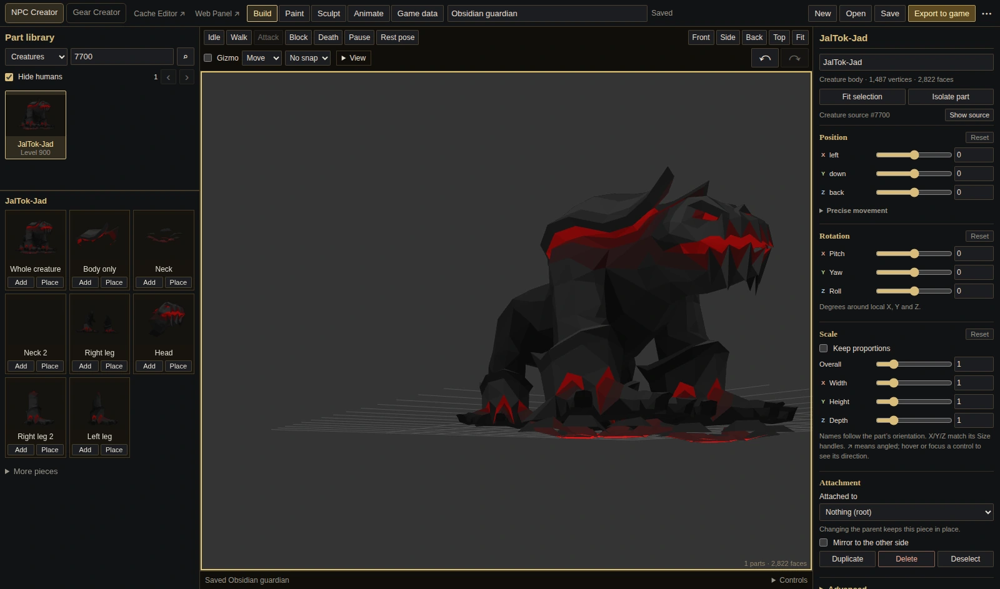
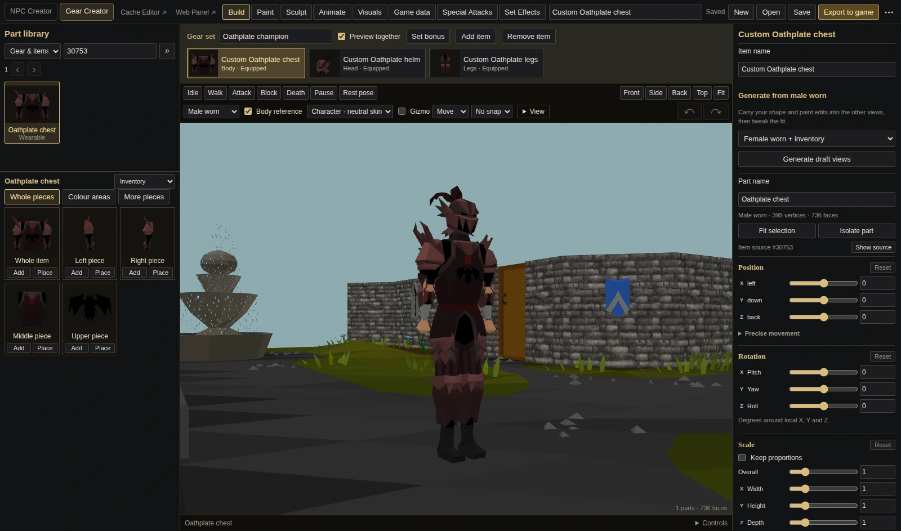

# NPC and gear Creator

Author: GhostScape. Source: the matching GhostScape feature changes for RSPSApp/tsps.

Optional NPC and gear Creator with portable exports. Requires the TSPS tool host, sampled animations, custom combat and gear visual support.

Install the release ZIP in the server Plugins panel and restart the server. This package does not patch or rebuild the client. Use a TSPS build with the integrations listed above. The source entry ends in `.entry.js` so it is not auto-loaded alongside this package.

Start the receiving world with `CACHE_EDITOR_ENABLED=1`, open its client with `?cache=1`, and choose NPC Creator or Gear Creator. Editable projects stay under the installed plugin data directory. Finished exported plugins run without the Creator service. Existing cache textures and native gear rigs are required; independent part animation is creature-only.

Rebuild from a matching TSPS checkout with `node tools/content-builders/package.mjs`; extract `ContentBuilders.plugin.js` from the generated ZIP into this directory. The embedded authoring assets are generated from that source.

## Screenshots

